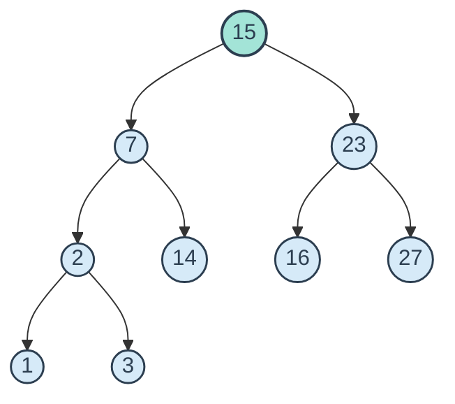

# Binary Search Tree: Inorder Traversal & Dynamic Visualization

[](https://colab.research.google.com/github/Swaraj0160/BST_inorder/blob/main/jurry.ipynb)
[](https://www.python.org/)
[](https://networkx.org/)
[](https://matplotlib.org/)
[](LICENSE)

An interactive, step-by-step animated visualizer and implementation of **Binary Search Tree (BST)** insertion and **Inorder Traversal (Left → Root → Right)** using Python, NetworkX, and Matplotlib.

---

## 🌳 Traversal Theory: Inorder on BST

In a valid Binary Search Tree, for any given node:
- All keys in its left subtree are strictly **less** than the node's key.
- All keys in its right subtree are strictly **greater** than the node's key.

Because of this recursive invariant, an **Inorder Traversal** (`Left → Node → Right`) visits the elements in **strictly non-decreasing, monotonically sorted order**.



**Resulting Inorder Sequence:**  
`[1, 2, 3, 7, 14, 15, 16, 23, 27]`

---

## 🎨 Visualization Mechanics

The notebook visualizes the tree at each algorithmic decision point with clear color coding and numerical step badges:

| State | Visual Indicator | Meaning |
|---|---|---|
| **Unvisited** | `#D6EAF8` (Light Cyan) | Node awaiting traversal in the recursive call stack |
| **Currently Visiting** | `#A3E4D7` (Mint Green) | Active frame where `node.key` is being processed and appended |
| **Visited** | `#F9E79F` (Soft Yellow) | Processed node with its completed traversal step badge displayed below |

- **Dynamic Layout Generation:** Recursive 2D coordinate calculation (`build_graph()`) positions nodes neatly across depth layers without edge overlap.
- **Step Delay Control:** Configurable animation delay (`0.5s` – `1.5s`) for classroom demonstrations and learning.

---

## ⚡ Complexity Analysis

| Operation | Average Case | Worst Case (Degenerate / Skewed) | Space Complexity |
|---|---|---|---|
| **Insertion** | $\mathcal{O}(\log n)$ | $\mathcal{O}(n)$ | $\mathcal{O}(\log n)$ |
| **Search** | $\mathcal{O}(\log n)$ | $\mathcal{O}(n)$ | $\mathcal{O}(\log n)$ |
| **Inorder Traversal** | $\mathcal{O}(n)$ | $\mathcal{O}(n)$ | $\mathcal{O}(h)$ call stack |

---

## 🚀 Running the Notebook

### Option 1: One-Click Google Colab (Recommended)
Click the badge above or navigate to:  
[**Open jurry.ipynb in Google Colab**](https://colab.research.google.com/github/Swaraj0160/BST_inorder/blob/main/jurry.ipynb)

### Option 2: Local Jupyter Environment
1. Clone the repository:
   ```bash
   git clone https://github.com/Swaraj0160/BST_inorder.git
   cd BST_inorder
   ```
2. Install dependencies:
   ```bash
   pip install networkx matplotlib ipython
   ```
3. Launch Jupyter:
   ```bash
   jupyter notebook jurry.ipynb
   ```
4. Run all cells and provide custom integer sequences or press Enter to run the pre-loaded 14-node demo dataset.

---

## 👤 Author & License

- **Author:** **Swaraj Ingale** ([@Swaraj0160](https://github.com/Swaraj0160))
- **License:** [MIT License](LICENSE)
