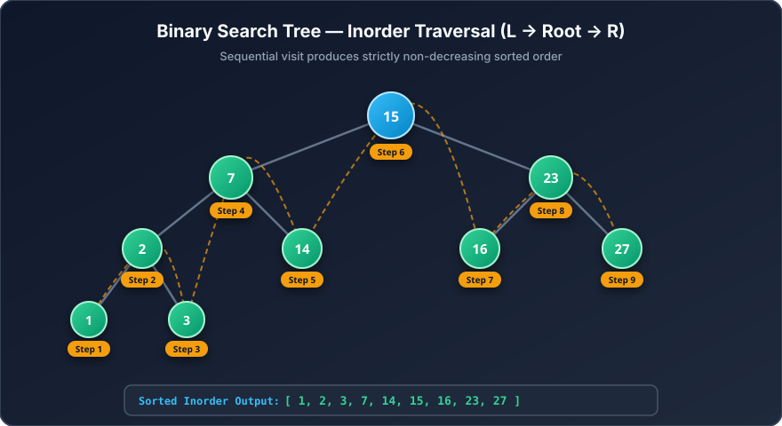

# Binary Search Tree: Inorder Traversal & Dynamic Visualization

<p align="center">
  <strong>Step-by-Step Algorithmic Tree Traversal & Recursive State Visualizer</strong><br>
  <em>Interactive Python visualizer demonstrating the recursive Inorder Traversal invariant (Left → Root → Right) yielding monotonically sorted output sequences using NetworkX and Matplotlib.</em>
</p>

<p align="center">
  <a href="https://colab.research.google.com/github/Swaraj0160/BST_inorder/blob/main/jurry.ipynb">
    
  </a>
  
  
  
  
</p>

---

## Overview

**Binary Search Tree: Inorder Traversal & Dynamic Visualization** is an educational algorithmic visualizer and data structures reference implementation authored in Python (`jurry.ipynb`). By integrating **NetworkX** graph hierarchies with **Matplotlib** dynamic plotting, the notebook transforms abstract recursive call stacks into step-by-step visual tree animations.

The visualizer specifically demonstrates one of computer science's fundamental data structure invariants: why an **Inorder Traversal** (`Left → Node → Right`) over a valid Binary Search Tree always visits elements in **strictly non-decreasing, sorted order**.

---

## The Tree Traversal Pedagogy Bottleneck & The Visualizer Solution

### The Challenge
- **Abstract Call Stacks:** Computer science students frequently struggle to visualize how recursive stack frames unwind from deep leaf nodes back to ancestors.
- **Static Textbook Diagrams:** Traditional static diagrams only show the final tree topology without illustrating the temporal order in which nodes are visited and appended to the output array.
- **Overlapping Node Coordinates:** Basic graph drawing utilities frequently overlap nodes or produce tangled edges when plotting unbalanced or multi-tier binary trees.

### The Visualizer Solution
- **Temporal Step Badging:** Every visited node receives an explicit numeric sequence badge (e.g., `Step 1`, `Step 2`, `...`, `Step 9`), revealing the exact execution order.
- **Tri-Color Frame State Animation:** Nodes transition dynamically across three distinct visual states: *Unvisited* (`#D6EAF8`), *Currently Visiting* (`#A3E4D7`), and *Visited / Output Confirmed* (`#F9E79F`).
- **Deterministic 2D Coordinate Layout:** A recursive depth-stratified coordinate builder positions left and right child subtrees without edge crossing.
- **Zero-Setup Cloud Execution:** Bundled with a one-click Google Colab badge for instant interactive execution without local Python installation.

---

## Visual Showcase: Inorder Traversal Mechanics

The vector diagram below illustrates the exact 9-node Binary Search Tree and execution path implemented in `jurry.ipynb`:



*Inorder traversal order: Leftmost leaf `1` (Step 1) → Parent `2` (Step 2) → Right child `3` (Step 3) → Ancestor `7` (Step 4) → Sibling branch `14` (Step 5) → Root `15` (Step 6) → Right subtree `16` (Step 7) → Node `23` (Step 8) → Maximum leaf `27` (Step 9). Output sequence is strictly sorted: `[1, 2, 3, 7, 14, 15, 16, 23, 27]`.*

---

## Algorithmic Theory & Traversal Invariant

In any valid Binary Search Tree, every node $x$ satisfies the BST invariant:
- For every key $y$ in the left subtree of $x$: $y < x.\text{key}$
- For every key $z$ in the right subtree of $x$: $z > x.\text{key}$

```text
Algorithm Inorder(Node):
  1. If Node is NULL, return.
  2. Inorder(Node.left)
  3. Process(Node.key)       <-- Appended to result list
  4. Inorder(Node.right)
```

By induction, visiting the entire left subtree ($< x$), recording $x$, and then visiting the right subtree ($> x$) produces a monotonic sorted progression across all nodes.

---

## Core Implemented Capabilities

### 1. Object-Oriented BST Engine
- Custom `Node` and `BST` classes encapsulating key insertion, binary partitioning, and recursive tree traversals.
- Preservation of tree invariants without duplicate-key corruption.

### 2. NetworkX Visual Coordinate Builder
- Custom 2D layout calculation dynamically assigning $(X, Y)$ plane coordinates based on tree depth and horizontal branch width.
- Eliminates node collisions regardless of whether subtrees are balanced or skewed.

### 3. Animated Step-by-Step Rendering
- Clear color coding:
  - **Light Blue (`#D6EAF8`):** Unvisited node pending in stack.
  - **Mint Green (`#A3E4D7`):** Active node in current frame.
  - **Gold / Yellow (`#F9E79F`):** Visited node with sorted index badge.
- Configurable animation delay parameter (`0.5s` – `1.5s`) for classroom demonstrations.

---

## Complexity Analysis

| Operation | Average Case | Worst Case (Degenerate) | Space Complexity |
|---|---|---|---|
| **Tree Insertion** | $\mathcal{O}(\log n)$ | $\mathcal{O}(n)$ | $\mathcal{O}(\log n)$ recursive |
| **Search Key** | $\mathcal{O}(\log n)$ | $\mathcal{O}(n)$ | $\mathcal{O}(\log n)$ recursive |
| **Inorder Traversal** | $\mathcal{O}(n)$ | $\mathcal{O}(n)$ | $\mathcal{O}(h)$ call stack |

*Where $n$ represents the total number of nodes, and $h$ represents the maximum tree height ($h = \log_2 n$ balanced, $h = n$ skewed).*

---

## Repository & Directory Structure

```text
BST_inorder/
├── assets/
│   └── bst_visualization.svg   # High-resolution vector diagram of the BST traversal flow
├── jurry.ipynb                 # Interactive Jupyter Notebook with complete implementation
├── LICENSE                     # MIT Open-Source License
├── README.md                   # Technical documentation and visualization guide
└── SECURITY.md                 # Security and vulnerability reporting policy
```

---

## Running the Visualizer

### Option 1: One-Click Google Colab (Recommended)
Launch the notebook in Google Colab with zero configuration:  
👉 **[Open jurry.ipynb in Google Colab](https://colab.research.google.com/github/Swaraj0160/BST_inorder/blob/main/jurry.ipynb)**

### Option 2: Local Python / Jupyter Environment
1. Clone the repository:
   ```bash
   git clone https://github.com/Swaraj0160/BST_inorder.git
   cd BST_inorder
   ```

2. Install dependencies:
   ```bash
   pip install matplotlib networkx ipykernel jupyter
   ```

3. Launch Jupyter:
   ```bash
   jupyter notebook jurry.ipynb
   ```

---

## Author & Acknowledgements

- **Developer:** **Swaraj Ingale** ([@Swaraj0160](https://github.com/Swaraj0160))
- **Topic:** Data Structures & Algorithms (Trees, Graphs, Recursion)
- **License:** Open-source under the [MIT License](LICENSE).
